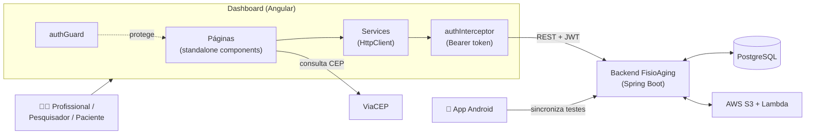

# FisioAging — Dashboard Web

> Plataforma web para consulta, análise e gestão dos testes **UTT** (*Unipedal Toe Test*) e **2MST** (*Two-Minute Step Test*) realizados em idosos.

Trabalho de Conclusão de Curso do curso de Tecnologia em Análise e Desenvolvimento de Sistemas — Setor de Educação Profissional e Tecnológica (SEPT) da **Universidade Federal do Paraná (UFPR)**, desenvolvido em parceria com a Pós-graduação em Educação Física da UFPR e integrado ao ecossistema do projeto **TecnoAging**.


---

## Sumário

- [Contexto](#contexto)
- [O FisioAging](#o-fisioaging)
- [Funcionalidades](#funcionalidades)
- [Perfis de acesso](#perfis-de-acesso)
- [Arquitetura](#arquitetura)
- [Tecnologias](#tecnologias)
- [Estrutura do projeto](#estrutura-do-projeto)
- [Integração com o backend](#integração-com-o-backend)
- [Como executar](#como-executar)
- [Deploy](#deploy)
- [Limitações e trabalhos futuros](#limitações-e-trabalhos-futuros)
- [Repositórios relacionados](#repositórios-relacionados)
- [Equipe](#equipe)

---

## Contexto

O envelhecimento populacional no Brasil é uma realidade crescente: segundo o Censo 2022 do IBGE, mais de 32,1 milhões de pessoas têm 60 anos ou mais (15,8% da população). Nesse cenário, a **fragilidade** — síndrome clínica marcada pela redução das reservas fisiológicas e pelo aumento da vulnerabilidade a quedas, hospitalizações e incapacidades — exige formas de avaliação precisas e acessíveis.

Testes funcionais como o **UTT** (elevação na ponta dos pés, que avalia força e resistência da panturrilha) e o **2MST** (marcha estacionária de dois minutos, que avalia resistência aeróbica) são amplamente utilizados, mas sua aplicação tradicional depende da observação direta do avaliador: os resultados são subjetivos, não ficam registrados de forma padronizada e não formam um histórico acessível.

## O FisioAging

O FisioAging substitui essa avaliação subjetiva por métricas calculadas a partir dos sensores inerciais do celular. A solução é composta por quatro partes:

| Módulo | Tecnologia | Responsabilidade |
|---|---|---|
| **Aplicativo mobile** | Android / Kotlin | Orienta a execução dos testes, captura os dados do acelerômetro e do giroscópio e sincroniza os testes com o servidor |
| **Backend** | Java / Spring Boot | Autenticação, cadastros, registro das execuções, envio ao S3, recuperação dos resultados, dashboard e relatórios |
| **Processamento** | Python / AWS Lambda | Limpa o ruído dos sinais e calcula as métricas de cada teste |
| **Dashboard web** *(este repositório)* | Angular | Indicadores, gestão de usuários e unidades de saúde, consulta dos testes e relatórios |

O dashboard é a porta de entrada para **profissionais de saúde, pesquisadores e pacientes** acompanharem os resultados processados, permitindo que o histórico de cada paciente seja consultado a qualquer momento, por diferentes profissionais e unidades de saúde.

## Funcionalidades

| Rota | Tela | O que oferece |
|---|---|---|
| `/login` | **Login** | Autenticação por e-mail e senha, com validação dos campos |
| `/home` | **Dashboard** | Cards com total de pacientes, testes no período (último mês, mês atual, últimos 3 meses ou este ano) e classificação de desempenho (acima, na média e abaixo da média); gráfico de testes por tipo; evolução mensal; distribuição dos testes por região, cidade, bairro, faixa etária e sexo |
| `/usuarios` | **Usuários** | Listagem com busca, cadastro, edição e exclusão de pacientes, profissionais e pesquisadores, além de atalho para os testes de cada paciente |
| `/testes` | **Testes realizados** | Tabela com teste, paciente, CPF, data/hora, repetições, altura média, cadência, classificação e unidade; busca, filtros e geração de relatório |
| — | **Detalhes do teste** | Relatório individual com dados do paciente e do teste, métricas calculadas, classificação e gráfico de desempenho por repetição, com opção de impressão |
| `/unidades-saude` | **Unidades de saúde** | Listagem com busca, cadastro, edição e exclusão de unidades (validação de CNPJ) |
| `/gerar-relatorio` | **Relatórios** | Filtros por período (obrigatório), paciente, unidade de saúde e idade; download do relatório em PDF |
| `/perfil` | **Meu perfil** | Edição dos próprios dados pessoais, endereço, unidade de saúde e senha |

**Recursos dos formulários**
- Preenchimento automático de rua, bairro, cidade e UF a partir do CEP, via [ViaCEP](https://viacep.com.br/);
- Máscaras para CPF, CEP e telefone;
- Validação de e-mail, CPF, CNPJ, data de nascimento e força da senha (mínimo de 8 caracteres, com letra maiúscula, minúscula e número).

## Perfis de acesso

O menu e as telas se adaptam ao perfil do usuário autenticado:

| Perfil | Acesso |
|---|---|
| **Profissional** | Acesso completo: dashboard, usuários, testes, unidades de saúde, relatórios e perfil |
| **Pesquisador** *(perfil `Admin` no backend)* | Consulta de testes e unidades de saúde, e edição do próprio perfil |
| **Paciente** | Consulta apenas dos próprios testes e edição do próprio perfil |

## Arquitetura



**Autenticação**
1. A tela de login chama `POST /auth/login` e guarda o token JWT e o ID do usuário no `sessionStorage`.
2. O `authInterceptor` adiciona `Authorization: Bearer <token>` a todas as requisições.
3. O `authGuard` bloqueia as rotas internas quando não há token e redireciona para `/login`.
4. As páginas são carregadas sob demanda (*lazy loading*) com `loadComponent`.

## Tecnologias

- **Angular 21** com *standalone components*, *signals* e *Reactive Forms*
- **TypeScript 5.9** e **RxJS**
- **Tailwind CSS** (com Bootstrap pontualmente) para estilização
- Gráficos do dashboard e do relatório construídos com HTML/CSS, sem bibliotecas de gráficos
- **Jest** + `jest-preset-angular` para testes unitários
- **Docker** (build multi-stage com Node 24 e servidor **Nginx**) e **GitHub Actions** para CI

## Estrutura do projeto

```
dashboard/
├── src/
│   ├── app/
│   │   ├── components/          # Componentes reutilizáveis
│   │   │   ├── menu-lateral/        # Menu de navegação por perfil
│   │   │   ├── user-modal/          # Modal de cadastro/edição de usuário
│   │   │   └── unidade-saude-modal/ # Modal de cadastro/edição de unidade
│   │   ├── core/
│   │   │   └── interceptors.ts      # Inclusão do token JWT nas requisições
│   │   ├── guards/
│   │   │   └── login.guard.ts       # Proteção das rotas autenticadas
│   │   ├── pages/               # Telas da aplicação
│   │   │   ├── login/
│   │   │   ├── home/                # Dashboard de indicadores
│   │   │   ├── user-list/
│   │   │   ├── testes-list/         # Listagem e filtros de testes
│   │   │   ├── resultado-teste/     # Relatório individual do teste
│   │   │   ├── unidade-saude/
│   │   │   ├── gerar-relatorio/
│   │   │   └── perfil-usuario/
│   │   ├── services/            # Comunicação com a API
│   │   │   ├── login/
│   │   │   ├── usuarios/
│   │   │   ├── unidade-saude/
│   │   │   ├── testes/
│   │   │   └── dashboard/
│   │   ├── shared/interfaces/   # Tipos e contratos de dados
│   │   ├── app.routes.ts
│   │   └── app.config.ts
│   ├── environments/            # URL da API por ambiente
│   └── styles.css
├── .github/workflows/           # CI: build e push da imagem Docker
├── dockerfile
├── nginx.conf
├── proxy.conf.json
├── tailwind.config.js
└── angular.json
```

## Integração com o backend

O dashboard consome a API REST do [backend do FisioAging](https://github.com/TCC-IDOSOS/backend):

| Service | Endpoints utilizados |
|---|---|
| `LoginService` | `POST /auth/login` |
| `DashboardService` | `GET /dashboard/stats` |
| `UsuariosService` | `GET /users/all`, `GET /users/{id}`, `POST /users`, `PUT /users/{id}`, `DELETE /users/{id}` |
| `UnidadeSaudeService` | `GET /health-unit`, `GET /health-unit/{id}`, `POST /health-unit`, `PUT /health-unit/{id}`, `DELETE /health-unit/{id}` |
| `TestesService` | `GET /users/tests?email=`, `GET /users/tests/{id}/result?email=`, `GET /reports/test-results` (PDF) |

A URL da API é definida nos arquivos de ambiente:

| Arquivo | Uso | `apiUrl` |
|---|---|---|
| `src/environments/environment.ts` | Desenvolvimento | vazio — as chamadas passam pelo proxy do `ng serve` |
| `src/environments/environment.prod.ts` | Produção | endereço do backend publicado |

Em desenvolvimento, o `proxy.conf.json` redireciona as rotas da API para o backend, evitando problemas de CORS.

## Como executar

### Pré-requisitos

- Node.js 20 ou superior (a imagem Docker usa Node 24) e npm
- Backend do FisioAging em execução (local ou publicado)

### Desenvolvimento

```bash
git clone https://github.com/TCC-IDOSOS/dashboard.git
cd dashboard
npm install
npm start
```

A aplicação fica disponível em `http://localhost:4200`.

Para apontar para um backend local, altere o `target` das rotas em `proxy.conf.json` para `http://localhost:8080` e inicie o servidor com o proxy:

```bash
npx ng serve --proxy-config proxy.conf.json
```

> O `proxy.conf.json` atual mapeia apenas `/users` e `/health-unit`. Para usar o proxy com todas as telas, inclua também `/auth`, `/dashboard` e `/reports`.

### Build de produção

```bash
npm run build
```

Os arquivos são gerados em `dist/dashboard/browser`.

### Testes

```bash
npm test
```

### Docker

```bash
docker build -t fisioaging-dashboard .
docker run -p 80:80 fisioaging-dashboard
```

A imagem compila a aplicação com Node e serve os arquivos estáticos com Nginx, configurado com `try_files` para suportar as rotas do Angular.

## Deploy

A cada push na branch `main`, o workflow [`deploy-docker.yml`](.github/workflows/deploy-docker.yml) gera a imagem Docker e a publica no Docker Hub como `dashboard-tcc:latest`. São necessários os secrets `DOCKER_USERNAME` e `DOCKER_PASSWORD` no repositório.

## Limitações e trabalhos futuros

**Limitações atuais**
- O sistema ainda precisa de validação mais ampla em ambiente real, com profissionais de saúde e pacientes idosos.
- A primeira versão contempla apenas os testes UTT e 2MST.
- Os recursos analíticos ainda podem evoluir, com filtros mais avançados e painéis personalizados.

**Próximos passos**
- Validação de usabilidade com usuários finais (profissionais, pesquisadores e pacientes).
- Relatórios comparativos entre avaliações e acompanhamento longitudinal da evolução dos pacientes.
- Exportação de dados para pesquisas acadêmicas.
- Suporte a novos protocolos de avaliação funcional.

## Repositórios relacionados

- [Backend](https://github.com/TCC-IDOSOS/backend) — API REST em Spring Boot e processamento em AWS Lambda

## Equipe

- Alan Patrick Konhevalic
- Ariane do Nascimento de Souza
- Cristhian Rodrigues Kindermann
- Natan Susin Cervinski
- Thales Assis de Oliveira

**Orientadora:** Profa. Dra. Rafaela Mantovani Fontana
**Banca:** Prof. Dr. Alessandro Brawerman

Monografia aprovada em 09 de junho de 2026 — Universidade Federal do Paraná, Curitiba/PR.
